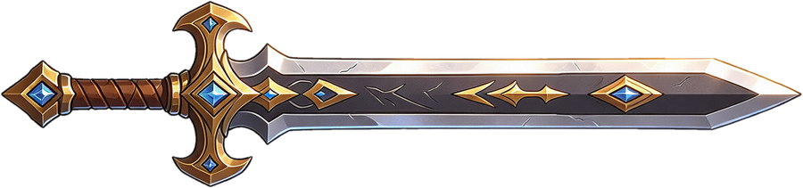
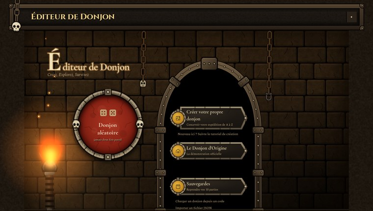
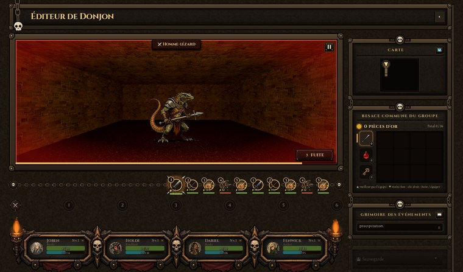
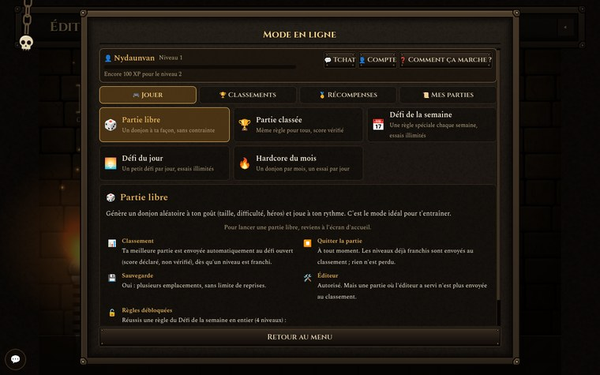
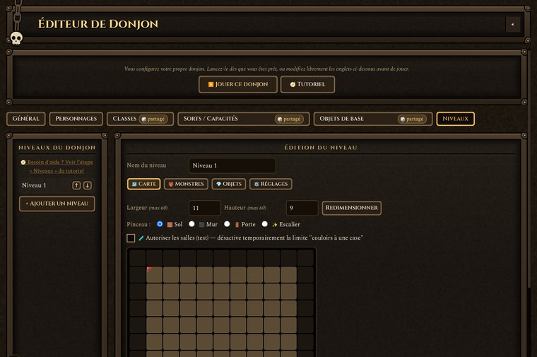

<h1 align="center">Éditeur de Donjon</h1>

<em>Créez, explorez, survivez.</em>

Un jeu de donjon en vue subjective et en 3D : on mène un groupe de quatre héros dans des labyrinthes générés au hasard ou créés soi-même, on combat, on récupère du butin et on descend toujours plus profond. C'est un jeu à part entière, écrit en GDScript sous Godot Engine 4.7.

 

 

**▶ Télécharger la dernière version : [Releases](https://github.com/Nydaunvan/Dungeon-Generator/releases)** (installateur Windows, archive Windows ou Linux). Le jeu se met ensuite à jour tout seul : il ne télécharge que les fichiers modifiés.

## Le jeu
- **Exploration 3D** au pas à pas : couloirs, portes et grilles, escaliers, niches, torches, fontaines, pièges (pointes d'acier, vapeur verte, mécanisme mural à fléchettes, fosse béante et cercle de runes de flammes en vrai volume, inoffensifs une fois désamorcés, avec un son propre à chaque piège) et casse-têtes (runes, dalles, cordes torsadées à trancher, 120 énigmes différentes), avec carte du niveau.
- **Un groupe de quatre héros** : caractéristiques, équipement, sacs, évolutions et arbre de talents. Sept classes de base (Guerrier, Archer, Roublard, Mage, Prêtre, Barde et **Druide**) qui évoluent au niveau 5 en deux voies chacune ; le Druide devient **Gardien de la Forêt** (soins sylvestres, écorce protectrice, arbre-monde) ou **Druide de la Tempête** (foudre, essaims, ouragan de feuilles, colère de la nature).
- **Combat au tour par tour** avec jauges d'initiative, sorts et effets visuels en 3D, statuts, monstres de groupe et boss. Tout monstre peut avoir une **rage** (au hasard, ou au choix de l'éditeur de niveaux) ; les boss ont aussi plus de PV (×1,8, ×2,2 pour le boss final), +10 % de dégâts et +25 % de récompenses dans les donjons aléatoires (réglable dans l'Admin) ; les boss en ont toujours une, sauf réglage contraire : sous un seuil de PV, un halo rouge l'entoure et ses dégâts augmentent. **Second souffle** : hors combat, les héros regagnent 1 % de leurs PV max tous les 6 / 8 / 12 / 20 pas selon la difficulté (plafond 60 %, prêtres et druides plus rapides, réglable dans l'Admin). Les chiffres de dégâts, soins et résistances s'empilent en lignes lisibles : sur le monstre pour ses événements, juste au-dessus de la carte du héros pour les siens. Chaque sort a son propre son, avec des sons dédiés pour l'attaque de base, la victoire d'un boss, les potions et la fontaine. **Instinct de survie** : quand un coup de monstre allait tuer un héros, un bouton rouge à anneau décroissant permet de tenter un réflexe (une fois par héros et par combat) ; jet de dé selon le timing, la difficulté et la Constitution, effets propres à chaque classe en cas de réussite parfaite. La fiche de chaque héros détaille ses six résistances et ses sept capacités d'objets (dégâts de sort, exécution, saignement, dégâts critiques, épines, or, dernier souffle), avec chaque objet source au survol.
- **Donjons aléatoires** réglables (difficulté, taille, nombre de niveaux) et **éditeur de niveaux** intégré ; les donjons se partagent par code. À l'arrivée dans un niveau, aucun monstre n'est placé près du départ et tous restent calmes une douzaine de secondes : le joueur a le temps de s'orienter.
- **Raretés** : les objets d'équipement sont communs, inhabituels, rares, épiques, légendaires ou mythiques (couleur du nom et du cadre) ; chaque palier ajoute des capacités (critique, esquive, vol de vie, exécution, dernier souffle…). Les gardiens laissent au moins du rare, et un légendaire finit toujours par tomber.
- **Village** : forge, Maître des Talents, marchands itinérants et boutique. Chez le marchand, le bouton d'achat ou de vente est en haut de la fiche de l'objet, et la **sélection multiple** permet de vendre plusieurs objets d'un coup. Les armes et équipements proposés varient en puissance, avec toujours au moins une **belle affaire** nettement meilleure que ce que porte déjà le groupe : acheter reste intéressant à haut niveau.
- **Interface de jeu (identité « Atlas Noir »)** : refonte complète de l'écran de jeu d'après la maquette — bande du haut (emblème de boussole, titre, repère central « NIVEAU n / NOM » entre deux filets à losanges, commandes en capitales fines) ; colonne de gauche « Carte » (plan, légende à deux colonnes) ; vue 3D au centre avec une réglette d'orientation N/E/S/O en bas ; fiches de héros dessous (portrait, nom en Cinzel, PV rouges et endurance/mana, repère ambre pour le héros actif) ; colonne de droite « Inventaire commun » (six onglets à icône, grille de cases avec quantité en bas à droite, or, total et bouton « Inventaire »), « Carnet » sur parchemin (« Journal des événements ») et raccourcis en cercles numérotés (attaque + sorts 1 à 6) ; file d'initiative en filet fin à losanges ; plus de flammes ni de chaînes. Titre « DONJON / ATLAS NOIR » sur deux lignes ; fond noir uni (plus de texture brune) ; la file d'initiative s'affiche en bas de la vue pendant le combat (sous la barre de vie des monstres) puis disparaît ; le volet d'équipement du personnage a son cadre en bois remplacé par un cadre Atlas ; la vue 3D occupe toute la largeur de l'écran et les panneaux latéraux (carte transparente à gauche, inventaire et carnet à droite) sont posés par-dessus ; le bord haut de la vue « décroche » au-dessus de la carte ; fiches de héros à barres en biais, chiffres à droite ; Carnet en parchemin grainé. Palette obsidienne / ardoise / cuivre / ivoire / ambre, polices Cinzel + Spectral. Le portrait mobile reprend la même identité. Menu d'en-tête en icônes (Guide, Paramètres, Sauvegarde, puis ≡ pour Accueil / Compte / Admin / Langue / Quitter) ; le repère central affiche « NIVEAU n / nom du donjon » ; portraits détourés sur fond noir ; ascenseurs fins à curseur clair ; bouton de tchat réduit ; en jeu, modales et infobulles reprennent le décor Atlas (cadres à angles coupés, filet cuivre) ; au lancement d'un sort de soin, la fiche de héros survolée s'illumine. En combat : file d'initiative entière, posée au-dessus du chronomètre de tour ; barre de vie des monstres plus basse, en biais et rouge comme celles des héros ; pastille « Pause » tout en haut au centre ; colonnes de droite encore plus étroites. Ronds de sorts à anneau dégradé cuivre/ardoise avec repères et halo ambre au survol ; croix directionnelle réservée au mobile ; compteur de l'inventaire par catégorie (possédé / 12) ; barre de vie des monstres très fine, posée au-dessus de leur tête ; potions et parchemins rangés en largeur sous le carnet en combat ; repère de niveau descendu dans le décroché. Nouvelle boussole haute résolution (en-tête et pied de la carte) ; ronds de sorts plus gros sur deux rangées, qui s'allument quand on presse leur touche ; fiche de héros ciblable surlignée en ambre vif (halo, repères d'angle) ; besace à 5 catégories de 12 emplacements (armes, armures, potions, parchemins, clés), l'onglet « Tout » en affiche la somme (60). Coffres et leviers ne se déclenchent plus en marchant dessus : clic sur l'objet ou touche d'action (F par défaut, réglable dans Paramètres › Commandes), avec une invite « [F] Ouvrir le coffre » dans la vue ; le butin d'un coffre jaillit d'un saut et retombe en éventail devant lui sans jamais s'empiler, et ce qui ne tient pas dans la besace (ou tombe d'un monstre) reste au sol, ramassable plus tard ; levier mural remodelé en haute définition. **Techniques ultimes (7e sort)** : chaque classe évoluée (Berserker, Paladin, Mage-Archer, Danselame, Voleur, Assassin, Élémentaliste, Sorcier, Clerc, Croisé, Skalde, Ménestrel, Gardien de la Forêt, Druide de la Tempête) gagne à l'évolution (niveau 5) une technique ultime sur un 7e disque doré de la barre (touches 8 ou R, réglables) : cadenas tant que le héros est de classe de base, puis une jauge qui se remplit en frappant (+10), en encaissant (+6) ou en soutenant (+6) ; jauge pleine, le disque pulse et le sort se lance sans endurance ni recharge, la jauge repart de zéro. Effets : Rage Sanguinaire, Jugement Divin, Volée Arcanique, Tempête d'Acier (5 frappes), Rafle Éclair (or), Exécution (tue sous 30 % de PV), Cataclysme Élémentaire, Pacte Funeste (vol de vie), Miracle (soin, bouclier et relève d'un héros tombé), Croisade, Chant de Guerre, Berceuse Finale, Racines Ancestrales et Colère du Ciel, avec les effets graphiques et les sons des gros sorts existants. Réglages dans l'atelier : Règles du jeu › Combat › Technique ultime (jauge, niveau, gains), onglet Sorts (interrupteur « Technique ultime » et effets annexes) et onglet Classes (carte « Technique ultime »). L'accueil, le hub et l'administration gardent pour l'instant l'ancien décor.
- **Interface de jeu** : la sauvegarde (emplacements, nouvelle partie, export, import) se trouve dans le menu du haut ; la colonne de droite montre la carte (que l'on peut replier), la besace commune du groupe (texte « pièces d'or » et bouton « Inventaire » en petits caractères, pour rester sur une ligne avec le total) et un grand grimoire des événements, plus lisible, qui occupe toute la place restante.
- **Sept thèmes** de décor (matériaux, éclairage et ambiance propres à chacun), avec parfois du brouillard. Le Cachot humide a des murs et un plafond de briques brun-vert et un sol de terre rocailleuse, en relief (matériau 3D). Le thème Lave a des murs et un plafond de lave aux fissures incandescentes et un sol de roche. Le Temple ancien a des murs et un plafond de pierres plates et un sol de mousse.
- **Écrans « jeu vidéo »** : le mode en ligne adopte un style plein cadre (couloir de donjon animé aux torches, onglets à filet doré, grand bouton de lancement, icônes dessinées à la place des emojis, touches Haut/Bas/Entrée/Gauche/Droite/Échap) ; les autres écrans suivent peu à peu, la page d'accueil gardant son style.
- **Atelier de création** : l'administration devient un atelier à menu latéral (Accueil, Créer : Niveaux, Groupe et objets, Classes et talents, Sorts et capacités ; Règles du jeu : Combat, Progression, Exploration, Pièges et puzzles ; Projet : Identité et sécurité, Partage et sauvegarde). L'accueil propose trois portes (Créer, Régler, Partager), la reprise de la dernière section, les modifications récentes et les contrôles du donjon (niveau sans sortie, départ dans un mur, groupe vide). Recherche globale **Ctrl K** (réglages, sections, classes, sorts, objets) qui ouvre la page et fait clignoter le réglage trouvé. « Groupe de départ » et « Objets de base » sont réunis dans une même page à deux sous-onglets ; les mentions « partagé » disparaissent. Les pages de règles affichent chaque réglage en ligne (curseur + valeur), rappellent sa valeur « par défaut » dès qu'on s'en écarte, s'enregistrent toutes seules (plus de bouton « Enregistrer ») et peuvent être remises à leurs valeurs d'origine d'un clic. **Groupe de départ** : une carte par héros, puis sa fiche (portrait à choisir ou retirer, nom, classe, icône, caractéristiques en barres, équipement de départ, sorts connus en pastilles). **Objets de base** : grille de cartes colorées par rareté avec recherche et filtres par type, fiche à droite (rareté, capacités, caractéristiques selon le type). **Sorts et capacités** : liste à gauche (recherche, filtres Dégâts / Soins / Soutien / Zone, pastille d'école colorée) et fiche à droite (mode, caractéristiques, style visuel et aperçu). **Niveaux** : éditeur plein écran refait d'après la maquette (colonne des niveaux, carte centrale avec palette de pinceaux au clavier 1 à 8, inspecteur à onglets Carte / Monstres / Objets / Réglages, feuille basse en affichage étroit), enregistrement automatique. **Classes et talents** : liste des classes de base puis évoluées, et une fiche à onglets (Général, Armes et sorts, Progression, Talents, Évolution). Tout s'enregistre automatiquement.
- **Français et anglais**, guide du jeu et tutoriel intégrés, touches réassignables.

## En ligne (facultatif)
Le jeu reste entièrement jouable hors ligne. Avec un compte, on peut partager ses donjons, relever les défis, jouer des parties classées vérifiées (chaque partie est rejouée côté serveur), tenter le Hardcore du mois, gagner des badges, titres et cadres cosmétiques, discuter avec les autres joueurs et tenir une **liste d'amis** (demandes d'ami, état en ligne, message privé). L'équipe d'administration voit qui est en ligne et la date de dernière connexion de chaque joueur.

## Graphismes
Rendu Forward+ (Vulkan) avec repli automatique sur OpenGL. Quatre niveaux de qualité (Faible, Moyen, Élevé, Ultra) et un réglage Auto qui s'adapte à la machine. Les effets (occlusion ambiante, reflets, relief, brouillard volumétrique, étalonnage des couleurs) se règlent un par un dans **⚙ Paramètres › Graphismes**. F3 affiche, sur une seule ligne tout en haut à gauche (sans cadre), les images par seconde, la mémoire et le nombre d'appels de dessin.

**Effets de sorts** : chaque sort a son propre graphisme, cohérent avec son nom et son école, et l'éditeur de sorts propose un effet visuel au choix par école et par mode, avec une teinte, une intensité et un aperçu. Ces effets avancés (lumière HDR, particules GPU, plasma et flammes en shader, distorsion de l'air, motifs gravés au sol, lumière qui éclaire la brume) s'adaptent au niveau graphique ; l'effet d'origine reste disponible. Les 66 sorts ont leur propre effet : nature (épine venimeuse, ronces entravantes, foudre sauvage, essaim de guêpes, bourgeon de vie, souffle de la forêt, écorce protectrice, sève régénérante, arbre-monde, ouragan de feuilles, colère de la nature), arcane (cristal, orbe, rayon, ralentissement qui fige le temps, flèche runique, volée de cinq flèches, pluie de flèches stellaires), feu (boule de feu, météore, colonne de feu), glace (javelot de givre, tempête de grêle), sacré (pilier de lumière, châtiment, jugement, aura, flammes purificatrices, anathème) et soins (soin, célérité, bénédiction, guérison de groupe, sanctuaire), ombre (frappe fatale, drain de vie, ombre fugace, exécution, lame silencieuse, coup dans l'ombre, mille entailles, malédiction, pacte obscur, apocalypse), bardes (note perçante, souffle, armure de vers, cri de guerre, lame de l'épopée, berceuse, ballade, requiem, dissipation) et coups physiques (coup puissant, tir précis, attaque sournoise, rage, frénésie, coup décisif, fureur sanglante, frappe discordante, coup bas, poison de lame, frappe du croisé, danse des lames, tourbillon, pas de la lame, danse mortelle). Les monstres qui ont une capacité spéciale la lancent avec un vrai effet : le sort part du monstre vers le héros visé (projectile, pluie, éclat ou griffes selon le sort, aux couleurs de l'école). L'aperçu de l'éditeur montre les deux sens de tir.

## Commandes
Au clavier (touches physiques, libellés AZERTY) : ↑/Z avancer, ↓/S reculer, Q/D pas de côté, ←/A et →/E tourner. Tout est réassignable dans les paramètres, et des boutons à l'écran permettent le jeu tactile.

## Lancer depuis les sources
1. Cloner le dépôt : `git clone https://github.com/Nydaunvan/Dungeon-Generator.git`
2. Ouvrir `project.godot` dans [Godot 4.7](https://godotengine.org/) et lancer le projet (F5).

## Pour les développeurs
Structure du code, vérifications automatiques, publication des versions, partie en ligne et rejeu vérifié : voir la [documentation technique](docs/TECHNIQUE.md).

## Organisation du dépôt
| Dossier | Contenu |
|---|---|
| `scripts/` | Le code du jeu (GDScript) : règles, donjon 3D, interface, services et éditeur de donjon. |
| `scenes/` | Les scènes Godot du jeu. |
| `data/` | Les données du jeu : configuration, textes, réglages graphiques, journal des versions. |
| `assets/` | Les ressources utilisées par le jeu : images, textures, sons, musiques, polices. |
| `assets_src/` | Les images sources, d'origine, dont sont tirées certaines ressources ; le jeu ne les charge pas. |
| `supabase/` | Le schéma de la base de données de la partie en ligne. |
| `tools/` | Les outils de développement : vérifications, captures, génération de ressources, préparation des publications. |
| `installer/` | L'installateur Windows et l'entrée de menu Linux. |
| `.github/` | La publication automatique des versions. |
| `docs/` | La documentation technique et les images du README. |

Le détail des sous-dossiers est dans la [documentation technique](docs/TECHNIQUE.md#sous-dossiers). La branche `migration/donnees` est la branche de développement : les versions sont publiées depuis elle.
- Administration : onglet Tests, lancer une partie de test de n'importe quelle règle de défi, au format semaine ou jour (hors classement).
- Héros solitaire : PV ×2 et dégâts +1/3 (attaques et sorts), héros affiché dans la deuxième fente du bandeau d'équipe. Défi de la semaine : donjon de 15 × 15 sur deux niveaux, héros parti avec une arme rare, équipement trouvé ou vendu par les marchands rare au minimum (épique, légendaire, mythique possibles), XP ×2, butin ×2,5 (modificateur « Butin de choix »), monstres un peu plus costauds (+25 % de PV, +15 % de dégâts). La fin de partie d'un défi (semaine, jour, mois hardcore) propose uniquement « Retour à l'accueil » (qui rouvre le mode en ligne si la partie en venait, sinon le menu général ; ni village, ni donjon plus difficile) ; les boutons de fin de partie sont empilés.
- Tous les effets de sorts partent des cartes du groupe ou y arrivent, par-dessus l'interface ; le coup d'un monstre frappe la carte du héros touché ; l'attaque normale reste sur le monstre (option « Effets sur les cartes », essai).
- Les statuts durent visuellement autant que leur effet : tant qu'un monstre est endormi (berceuse du ménestrel), empoisonné, brûlé, gelé, étourdi, ralenti ou affaibli, ses « Z », bulles, flammes, givre ou étoiles restent sur lui ; sur les héros, l'effet reste sur leur carte. Un boss a toujours une capacité spéciale.
- Cartes du bandeau : une pastille par statut actif (icône + tours restants, jusqu'à quatre puis « +n »), visible par-dessus les effets ; ces effets (flammes, givre, bulles, étoiles…) courent désormais en anneau autour du cadre de la carte et ne couvrent plus ni le nom ni les barres ; le détail chiffré est dans l'infobulle de survol et la fenêtre Groupe.
- Fenêtre Groupe (onglet Statistiques) : section « Statuts » sous le nom du personnage, avec les statuts actifs (gel, brûlure, poison, célérité…), les tours restants et le détail chiffré de leurs effets, ou « Aucun statut actif ».
- Fenêtres d'évolution de classe et de choix de talent : chaque voie affiche son icône (Mage-Archer, Berserker, Élémentaliste, Sorcier… n'en avaient pas), le titre et la description à la ligne.
- Poses des monstres : un monstre peut avoir trois illustrations, normale, attaque et coup reçu (`assets/monsters/mNN.webp`, `mNN_attack.webp`, `mNN_hit.webp`). En combat, il prend la pose d'attaque quand il frappe et celle du coup reçu (en plus du flash rouge) quand un aventurier le touche, puis reprend sa pose normale. Monstres équipés : le gobelin des cavernes et le rat géant (images en 1024 px, bords anticrénelés) ; les autres monstres gardent leur unique illustration.
- Sorts de dégâts du Druide rééquilibrés : moins de dégâts, recharge plus longue et statuts moins fréquents (les sorts modifiés par le créateur ne sont pas touchés).
- Piège « sacrifier un objet » : on peut jeter dans le mécanisme n'importe quel objet du sac (potion, parchemin, arme, armure, bijou…), sauf les clés.
- Piège « Effort collectif » : toujours proposé en plus des méthodes du piège. Jet de dé (Constitution du groupe), chaque héros vivant y laisse 35 % de son endurance max ; échec : tout le groupe est touché à dégâts réduits. Réglable dans l’administration.
- Rejeu : tout ce que fait le joueur est montré, y compris l'ouverture de l'inventaire, la sélection d'un objet, équiper/retirer/jeter/trier/boire/forger.
- Statuts détaillés (dégâts par tour, soin, vitesse, protection, durée restante) dans la bulle de survol d'un personnage, la fiche d'un monstre et le calcul des caractéristiques de l'inventaire.
- Bouton « 🎒 Inventaire » sur la besace ; bestiaire avec l'image du monstre ; sort grisé faute d'endurance ; touche de sort trop tôt mémorisée 1,5 s (plus de double appui) ; l'« Effort collectif » affiche l'endurance totale dépensée ; les parchemins ne demandent ni ne dépensent d'endurance ; point rouge clignotant sur l'onglet Amis et sur le sceau « Expédition en ligne » de l'accueil quand des demandes d'amis attendent.
- Inventaire : un clic en dehors du volet le referme en glissant, comme à l'ouverture.
- Barre de sorts : un sort qui peut infliger un statut porte une petite pastille (icône du statut, anneau rouge nuisible / vert bénéfique).
- Donjons aléatoires : couloirs ET salles (zones ouvertes de 3×3 à 5×5 cases, réparties régulièrement, jamais plus d'un tiers du sol ; départ et sortie toujours dans un couloir). Salles décorées selon un **style** par salle (bibliothèque, salle d'armes, cellier, autel, ruine, salle commune, salle humide ; trésor, repaire du boss et marché selon le contenu) : accessoires modélisés en 3D (tonneaux, caisses, bibliothèques, râteliers, braseros, tas d'or, trône…) contre les murs, sol propre, lustre ou braseros, ambiance (poussière, braises, brume), pièce maîtresse dans la plus grande salle, jamais deux voisines identiques ; choix du style par salle dans l'onglet Réglages de l'éditeur, y compris pour les salles dessinées à la main, où la limite « couloirs d'une seule case » et sa case à cocher ont disparu. Parties classées d'avant la 1.37.0 : rejouées avec l'ancien labyrinthe.
- Coffres 3D animés (couvercle qui se soulève, éclat doré) dans les donjons aléatoires : posés contre un mur, dans une salle le plus souvent ou un couloir, sans jamais bloquer le passage ; ils s'ouvrent à l'arrivée du groupe et livrent de l'or et 1 à 3 objets (ce qui ne tient pas dans le sac reste dans le coffre). Visibles sur la mini-carte. **Outil Coffre** dans l'éditeur de niveaux (onglet Objets, type « Coffre ») : côté du mur (auto ou N/E/S/O), or, et jusqu'à quatre objets pris dans la bibliothèque.
- Les pièges générés sont toujours sur le passage obligé vers la sortie, jamais dans une impasse ; faute de place, un objet à ramasser les remplace.
- Guide : un tableau qui ne tient pas dans la fin d’une page est coupé par lignes (en-tête répété) au lieu de laisser un grand vide ; un intitulé reste avec son paragraphe.
- Hache pendulaire : sur certains niveaux (à partir du 2ᵉ, une chance sur trois par défaut), un couloir rectiligne est barré par une grande hache à double tranchant qui balaie le passage d'un mur à l'autre et s'enfonce dans une fente à chaque bout. En passant dessous, chaque héros tente de l'esquiver (Dextérité, popup « Esquive ! » au-dessus de lui) ; les autres sont blessés, et le piège reste actif à chaque passage. Rester sur la case de la hache relance le jet de tout le groupe toutes les 2 secondes (même principe), tant que la hache n'est pas bloquée. La première fois, des gravures indiquent la direction d'un interrupteur mural de contrepoids caché ailleurs sur le niveau (plaque de fer rivetée, grand levier à manche de bois) : en le rejoignant, le levier bascule du haut vers le bas, la lame se coince dans sa fente et le couloir est libre. Chances, esquive et dégâts se règlent dans l'administration (réglages des pièges). Chaque passage de la lame fait un souffle sonore, audible de loin, qui s'arrête quand la hache est bloquée.
- Écran **« Préparer l'expédition »** (partie libre) : une seule fenêtre remplace les deux anciennes. Quatre cartes de héros en arche (portrait, rôle, quatre jauges FOR/DEX/CON/INT, flèches pour changer de portrait, dé pour tirer la classe) et sept tuiles de classes de base : on choisit la classe de chaque héros, deux d'une même classe au maximum, ou « Compagnie au hasard » ; la fiche de la classe annonce ses deux évolutions du niveau 5. Plus bas : niveaux (1 à 8), largeur (13 à 60) et hauteur (11 à 60), jamais en dessous de 13 × 11, avec des préréglages et un aperçu des niveaux empilés, quatre difficultés, et les modificateurs d'expédition (jusqu'à 2) avec bonus en vert et revers en rouge. Une barre résume le choix avant « Générer et jouer ». Le Barde a désormais ses propres statistiques de départ : dextérité, puis intelligence, constitution et force.
- **Modificateurs d'expédition** (partie libre, jusqu'à 2) : Horde rapide, Nid de monstres (butin du boss toujours légendaire, trois fois plus de chances d'être mythique que la difficulté), Sans repos, Brouillard épais, Endurance limitée, Précision fatale, et six nouveaux (12 modificateurs au total, en grille de 4 colonnes) : 💢 Brutes (monstres +25 % PV et +15 % dégâts, XP +40 %, butin +25 %), 😡 Meute enragée (rage deux fois plus fréquente, or +40 %), ☠️ Couloirs piégés (pièges et haches +50 %, or +40 %), 🩸 Pas de second souffle (plus de regain de PV hors combat, XP +30 %), 🐺 Bandes organisées (groupes de monstres +80 %, butin d'objets +30 %, XP +20 %), 🛡️ Élites (monstres +50 % PV et +20 % dégâts mais 40 % moins nombreux, XP et or +35 % ; incompatible avec Nid de monstres). Chaque carte annonce son bonus (vert), son revers (rouge) et un niveau de risque de 1 à 3 crânes ; Précision fatale et Verre brisé sont incompatibles, et les dégâts cumulés des monstres sont plafonnés à ×1,5.
- Barre de vie des monstres en combat : une jauge sous les pieds de chaque monstre (et de chaque membre d'un groupe), face à la caméra, verte puis jaune puis rouge selon les PV restants ; elle se vide ou se remplit en douceur à chaque coup ou soin et disparaît avec le monstre.
- Infobulles d'objets (survol dans la besace, le volet d'équipement et la forge), refaites pour tous les types d'objets : cadre à la couleur de la rareté avec filet intérieur, losanges d'angle et lueur en tête ; en-tête avec icône encadrée, nom, type (« Épée », « Torse »…), rareté et valeur ; pour une arme, gros bloc « 2 – 3 Dégâts par coup » avec l'écart en % par rapport à l'arme équipée ; bonus à icônes (« +3 Force ») avec écart en vert / rouge et conséquence pour le héros ; pouvoirs de rareté en bleu clair, résistances en vert ; pied « Remplace : … » / « Équipé par … » et valeur de vente. Potions, clés et parchemins ont la même présentation (description à icône, valeur).
- Fiche du personnage : les capacités des objets rares (critique, esquive, vol de vie, dégâts de sort, exécution, poison, dégâts critiques, renvoi, or gagné, dernier souffle) sont maintenant comptées dans les valeurs affichées et détaillées dans l'infobulle (ligne « Raretés de l'équipement »).
- Objets déjà équipés : survoler un objet porté par un héros (emplacement de la fiche, forge) affiche ses statistiques, comme dans la besace mais sans comparaison.
- Défi « Armes seules » : chaque héros part avec une arme épique, et tout l'équipement trouvé ou vendu par les marchands est rare au minimum (épique, légendaire, mythique aux chances habituelles).
- Groupes de monstres : chaque dégât (ou saignement, poison…) s'affiche au-dessus du monstre qui le subit, et non plus au centre de l'écran ; un coup de zone fait apparaître un chiffre sur chaque membre touché.
- Effets des monstres selon leur famille, au hasard à la génération : l'araignée, le naga, le zombie et le loup-garou empoisonnent ; la momie et le cultiste affaiblissent ; le fantôme draine la vie ; les élémentaires de feu, diablotins, drakes et panthères brûlent ; l'élémentaire de glace gèle ; trolls, ogres, minotaures, gargouilles et golems de pierre étourdissent ; le béholder endort ou gèle ; etc. Rats, gobelins, loups, orcs, gnolls, squelettes et hommes-lézards n'en ont pas. Les boss en ont toujours un, plus fréquent et plus long. Réglable dans l'administration (général et colonne « Effet » des niveaux).
- Marchand : la fiche d'un équipement affiche toutes ses statistiques en haut, comme dans l'inventaire (capacité de rareté d'abord, puis les bonus) ; les boutons « Comparer avec » sont plus petits et rangés sur deux colonnes, avec le nom du héros et sa classe.
- Survol de l'attaque de base : dégâts, critique, vol de vie et endurance sont affichés (sans les touches du clavier). Sorts de base du Barde (Note Perçante) et du Druide (Épine Venimeuse, Ronces Entravantes, Bourgeon de Vie) alignés sur ceux des autres classes.
- Entrée en rage d'un monstre : grognement, onde de choc rouge, puis une aura de flammes rouges (façon « ki ») qui monte en puissance en une seconde, avec des braises qui s'élèvent ; elle reste tant que le monstre est enragé. Cette aura s'applique à tous les monstres enragés (boss ou non), et son grognement est bien audible. L'aura de rage et les effets de statut sont préchauffés au chargement du donjon, avec les effets de sorts, pour éviter tout ralentissement au premier combat.
- Résistances par école (physique, feu, glace, nature, sacré, ombre/arcane) : les monstres en ont selon leur famille, au hasard à la génération (élémentaire de feu : résiste au feu, faible à la glace ; morts-vivants : résistent à l'ombre, faibles au sacré ; golems : physique…), les boss toujours ; une valeur négative est une faiblesse (dégâts accrus). Les classes de héros ont leurs bonus et petites faiblesses, et les armures et bijoux épiques et au-delà peuvent en donner. Affichées sur la fiche du héros, la fiche du monstre et les objets ; en combat, « Résiste ! » et « Faiblesse ! » s'affichent. Réglables dans l'administration (général et colonne « Résist. » des niveaux).

## Monster Studio

Logiciel indépendant du jeu (dossier `monster-studio/`, projet Godot séparé) : importe vos monstres 2D, les transforme en 3D avec une IA locale (TripoSR par défaut), pose un squelette, anime (repos, marche, attaque, coup reçu, mort) et exporte en `.glb`. Voir `monster-studio/README.md`.
